# Kybl

**One file manager for every bucket, drive and server.** A fast, native app for macOS, Windows,
Linux, Android and iPhone (Tauri 2 + React + Rust): S3 and anything S3-compatible (Hetzner, AWS,
Cloudflare R2, Backblaze B2, Wasabi, DigitalOcean Spaces, MinIO, Ceph …), Azure Blob Storage,
Google Cloud Storage, Google Drive, OneDrive, Dropbox, WebDAV, SFTP, FTP/FTPS, SSH and your own disk,
side by side.

<p>
<a href="https://kybl.app/"><b>Website</b></a> ·
<a href="https://kybl.app/features/"><b>Feature gallery</b></a> (every screen, light and dark) ·
<a href="https://kybl.app/manual/"><b>User manual</b></a> ·
<a href="../../releases/latest"><b>Download</b></a>
</p>

<a href="https://kybl.app/features/#shot-app-browse"><picture><source media="(prefers-color-scheme: dark)" srcset="website/assets/shots/app-browse-dark.webp">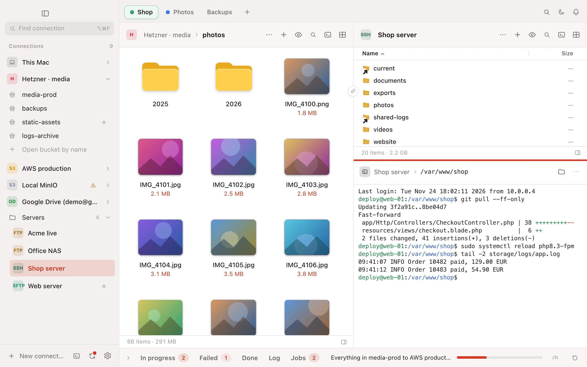</picture></a>

<table>
<tr>
<td width="50%"><a href="https://kybl.app/features/#shot-claude"><picture><source media="(prefers-color-scheme: dark)" srcset="website/assets/shots/claude-dark.webp">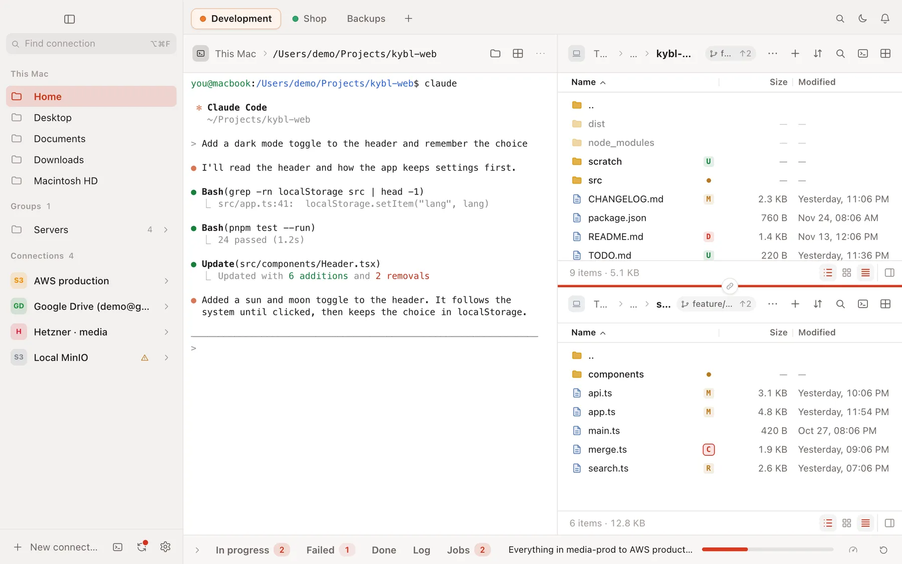</picture></a><br><b>A terminal next to your files</b> · <a href="https://kybl.app/manual/#terminal">how it works</a></td>
<td width="50%"><a href="https://kybl.app/features/#shot-mixed"><picture><source media="(prefers-color-scheme: dark)" srcset="website/assets/shots/mixed-dark.webp">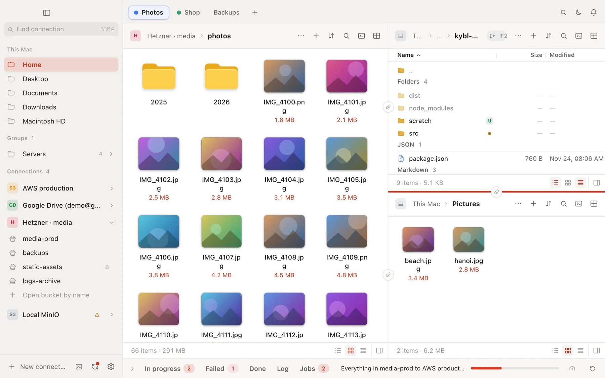</picture></a><br><b>Every pane its own view</b> · <a href="https://kybl.app/manual/#views">how it works</a></td>
</tr>
<tr>
<td width="50%"><a href="https://kybl.app/features/#shot-quicklook"><picture><source media="(prefers-color-scheme: dark)" srcset="website/assets/shots/quicklook-dark.webp">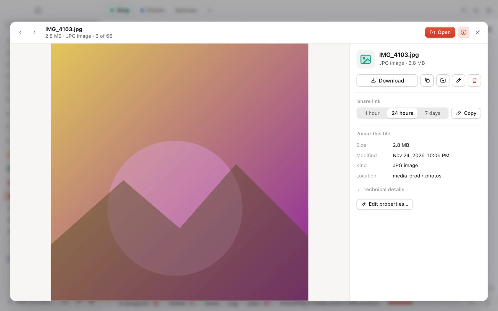</picture></a><br><b>Quick Look and Get Info</b> · <a href="https://kybl.app/manual/#quick-look">how it works</a></td>
<td width="50%"><a href="https://kybl.app/features/#shot-menu"><picture><source media="(prefers-color-scheme: dark)" srcset="website/assets/shots/menu-dark.webp">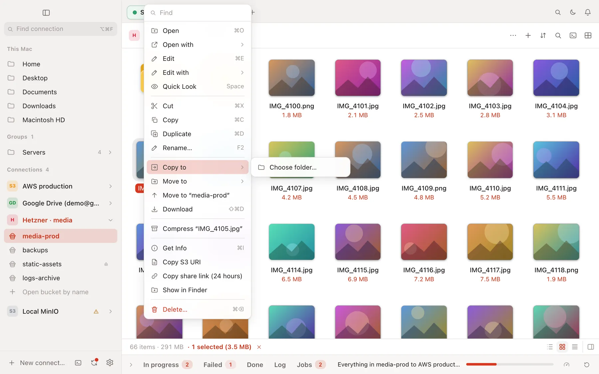</picture></a><br><b>Menus that do the whole job</b> · <a href="https://kybl.app/manual/#context-menu">how it works</a></td>
</tr>
<tr>
<td width="50%"><a href="https://kybl.app/features/#shot-mirror"><picture><source media="(prefers-color-scheme: dark)" srcset="website/assets/shots/mirror-dark.webp">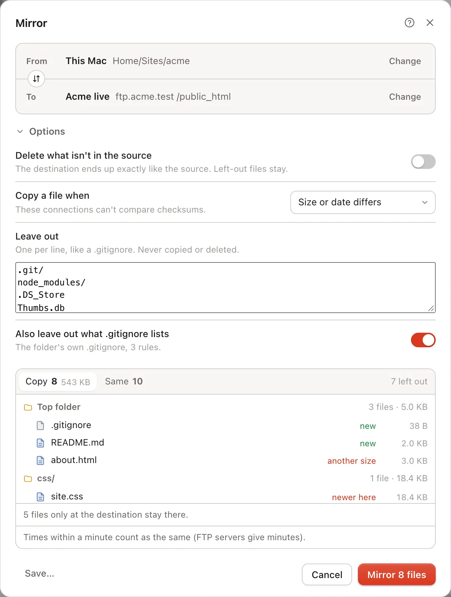</picture></a><br><b>Mirror with a dry run</b> · <a href="https://kybl.app/manual/#mirror">how it works</a></td>
<td width="50%"><a href="https://kybl.app/features/#shot-copymove"><picture><source media="(prefers-color-scheme: dark)" srcset="website/assets/shots/copymove-dark.webp">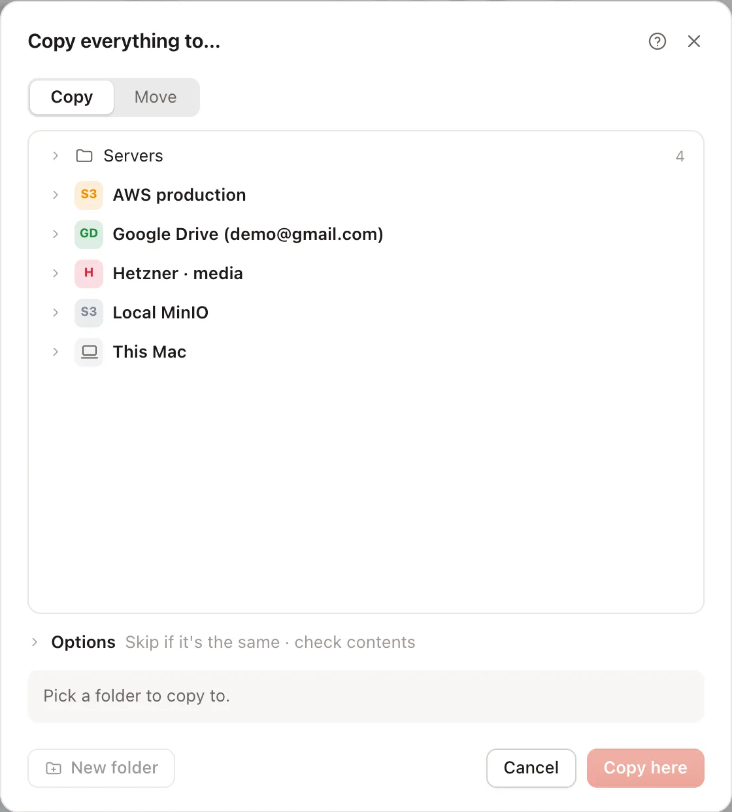</picture></a><br><b>Copy or move anything anywhere</b> · <a href="https://kybl.app/manual/#copy-move-dialog">how it works</a></td>
</tr>
<tr>
<td width="50%"><a href="https://kybl.app/features/#shot-app-sync"><picture><source media="(prefers-color-scheme: dark)" srcset="website/assets/shots/app-sync-dark.webp">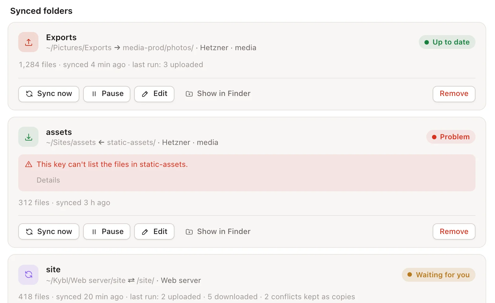</picture></a><br><b>Folder sync, even with the window closed</b> · <a href="https://kybl.app/manual/#sync">how it works</a></td>
<td width="50%"><a href="https://kybl.app/features/#shot-tunnels"><picture><source media="(prefers-color-scheme: dark)" srcset="website/assets/shots/tunnels-dark.webp">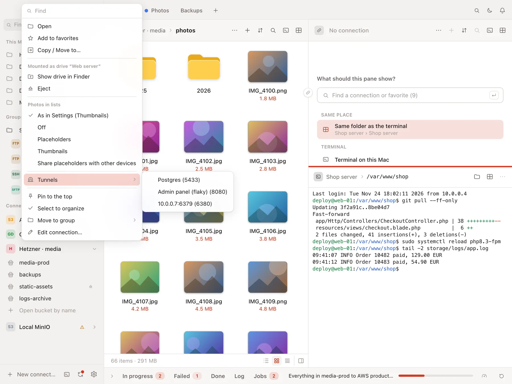</picture></a><br><b>SSH tunnels from the sidebar</b> · <a href="https://kybl.app/manual/#ssh-tunnels">how it works</a></td>
</tr>
<tr>
<td width="50%"><a href="https://kybl.app/features/#shot-rename"><picture><source media="(prefers-color-scheme: dark)" srcset="website/assets/shots/rename-dark.webp">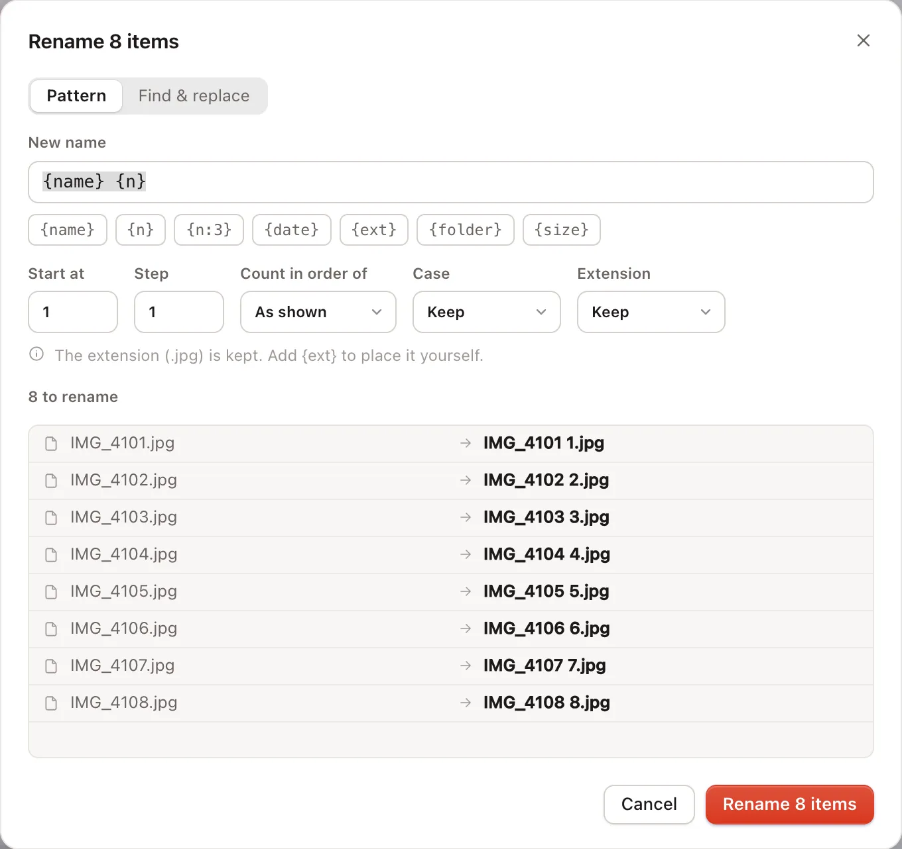</picture></a><br><b>Batch rename</b> · <a href="https://kybl.app/manual/#rename">how it works</a></td>
<td width="50%"><a href="https://kybl.app/features/#shot-compare-files"><picture><source media="(prefers-color-scheme: dark)" srcset="website/assets/shots/compare-files-dark.webp">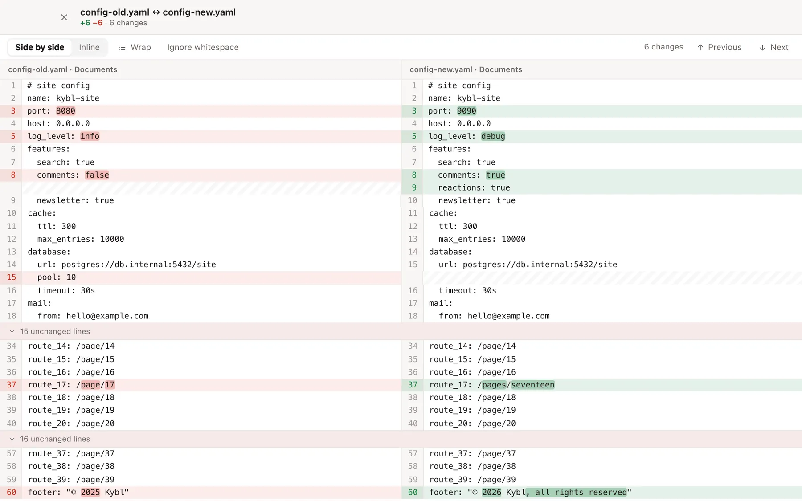</picture></a><br><b>Compare files and folders</b> · <a href="https://kybl.app/manual/#compare">how it works</a></td>
</tr>
<tr>
<td width="50%"><a href="https://kybl.app/features/#shot-workspaces"><picture><source media="(prefers-color-scheme: dark)" srcset="website/assets/shots/workspaces-dark.webp">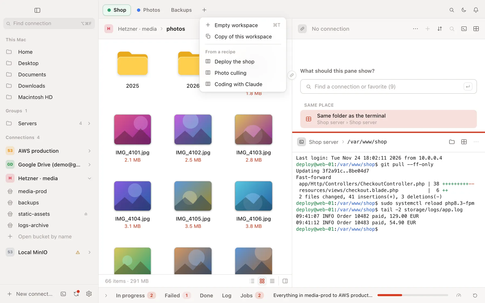</picture></a><br><b>Workspaces and recipes</b> · <a href="https://kybl.app/manual/#recipes">how it works</a></td>
<td width="50%"><a href="https://kybl.app/features/#shot-settings-appearance"><picture><source media="(prefers-color-scheme: dark)" srcset="website/assets/shots/settings-appearance-dark.webp">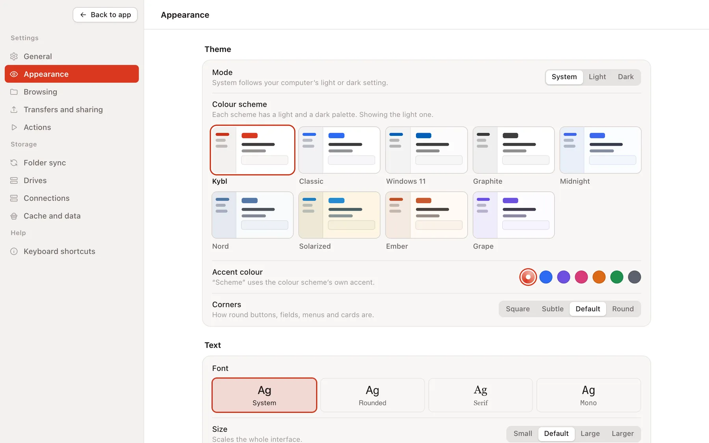</picture></a><br><b>Themes, colour schemes and fonts</b> · <a href="https://kybl.app/manual/#settings-appearance">how it works</a></td>
</tr>
</table>

More in the [feature gallery](https://kybl.app/features/): the sidebar and its menus, connections,
search, the command palette, the editor, archives, transfers and jobs, every settings page and the
phone app. Each part has a section in the [manual](https://kybl.app/manual/), which the app opens
from **Help** (F1, or ⇧⌘/ on a Mac) and from the **?** in its dialogs.

## Features
- **Connections**: S3-compatible (with presets), Azure Blob, Google Cloud Storage, Google Drive,
  OneDrive, Dropbox, WebDAV, SFTP, FTP/FTPS, SSH terminals and this computer. Import from FileZilla
  or `~/.ssh/config`. Secrets sit in an encrypted vault whose key is in the OS keychain.
- **Kybl Storage**: no bucket yet? Sign in with your email and the app connects itself (see below).
- **Panes and workspaces**: up to six panes in a window, each with its own view (list, grid,
  compact, grouped by kind, type, size or date). F5 copies and F6 moves between panes; compare,
  swap or browse two panes in step. Workspace tabs keep their layouts, and recipes start one fresh.
- **Terminals**: your computer's shell (PowerShell, Command Prompt, WSL and Git Bash on Windows)
  or SSH, in a pane below the files (⌘J), following the folder you're in. SSH tunnels start from
  the sidebar.
- **Browse**: breadcrumbs, back and forward, Go to folder, lazy paging for huge folders, search
  through every subfolder (match case, regular expressions), content search on disk and over SSH,
  favorites, git status in project folders, and the ⌘K command palette.
- **Thumbnails, Quick Look and Get Info**: thumbnails made and cached locally; Space previews
  images, video, audio, PDF, text and documents, with the file's details, share link and actions.
- **Edit**: text and code open in Kybl's own editor and Save uploads them; Edit opens a file in
  any app and uploads every save, or only when the server's copy hasn't changed.
- **Files**: upload, download, rename, batch rename, duplicate, new file and folder, delete with
  undo, drag and drop (also from Finder or Explorer), name clashes asked once, archives opened like
  folders, compressed and extracted, folder sizes on demand, share links.
- **Copy / Move to…**: a folder, a bucket or a whole connection to any other, as jobs that
  continue after a restart.
- **Mirror**: check what would be copied, deleted or left alone, then mirror; saved mirrors run
  again with one click.
- **Folder sync**: upload, download or two-way, from the menu bar with the window closed;
  conflicts kept as copies, deletions opt-in and confirmed when many go at once.
- **Mount as a drive** (macOS and Linux), **custom actions** (your own shell commands in the menu,
  with shortcuts) and **transfers** with speed, time left, pause, speed limits, retry and
  verify-after-copy.
- **Settings**: light, dark or system, nine colour schemes, accents, corners, fonts, text size,
  density, date and size formats, launch at login, reopen the last place, safety questions.
- **Updates** straight from GitHub Releases, no update server: checks at start and every few hours
  (or from the menu bar), then downloads, verifies the SHA-256 GitHub lists and installs in place
  with one click on macOS, Windows and AppImage; `.deb`/`.rpm`, Android and iOS open the download.
- **Phones**: the same app on Android and iPhone, with a touch UI, photo backup to any connection;
  transfers keep going in the background and dropped downloads resume where they stopped (see below).

## Kybl Storage
S3 storage run by Kybl, for people without a bucket of their own. Choose **Connect Kybl Storage**,
approve the computer or phone in the browser (or with a code on another device) and the app gets
its own access key: nothing to copy or type. The account site, [app.kybl.app](https://app.kybl.app/),
also makes access keys for any other S3 tool, and shows usage, devices and buckets.

- **10 GB free**; bigger plans are coming.
- **Encrypted at rest.** Every file is encrypted with a key of its own bucket (SSE-C, AES-256)
  before it touches the disk. The storage provider, its staff, its backups and anyone holding only
  the storage side see ciphertext; a read without the key fails. File names and sizes stay visible
  there.
- **Not end-to-end.** Kybl's servers do the encrypting, so they see files as they pass through.
  For data only you should ever read, encrypt it before uploading. Clients that send their own
  SSE-C key keep it: Kybl uses theirs and can't read those files either.
- Stored in the EU (Germany).

## Develop
```bash
pnpm install
pnpm tauri dev          # run
pnpm tauri build        # release bundle (.app / .dmg)
pnpm dev                # UI only, in a browser, with demo data (src/dev/devMock.ts); handy for design work
```
Requires Rust, Node and pnpm. Local macOS builds are ad-hoc signed; set `APPLE_SIGNING_IDENTITY`
to sign with your own identity.

Icons are generated from one drawing: `python3 scripts/build-icons.py` (needs `rsvg-convert`).

## iOS and Android
The same Rust backend runs on phones (Tauri 2 mobile), with its own touch UI in `src/mobile/`
(picked automatically on iOS/Android; open `pnpm dev` with `?mobile` to work on it in a browser).
Folder sync, the menu-bar icon and launch at login are desktop only.

- **Secret keys**: iOS Keychain on iPhone; on Android a file in the app's private storage,
  excluded from backups (`data_extraction_rules.xml`).
- **Downloads** go to *Files › On My iPhone › Kybl* on iOS and `Download/Kybl` on Android.
- **In the background**: on Android, uploads and downloads run in a foreground service
  (`TransferService.kt`, driven by `src/transfer_notice.rs`) that keeps the app from being frozen
  and shows the progress as a notification. They keep going when the app is swiped away in the
  app switcher: the process outlives its screen until the last transfer ends, and opening Kybl
  again picks the running transfers back up. A download whose connection drops (backgrounded on iOS,
  network change) picks up where it stopped with a ranged request for the same version of the file.
- **Uploads** use the system photo or document picker; Android `content://` files are copied to the
  cache first, then uploaded (multipart for big files) and the copy removed.
- **Connect Kybl Storage**: the account site opens in a Custom Tab on Android
  (`KyblConnectPlugin.kt`) or a sign-in sheet on iOS (`ASWebAuthenticationSession`, the Swift
  package in `gen/apple/KyblConnect`, linked by `build.rs`) and comes back to `kybl://connect` with
  the code; the rest is the desktop flow. Debug builds sign in against `127.0.0.1:8080`. The iOS
  simulator shares the Mac's loopback; on the Android emulator run `adb reverse tcp:8080 tcp:8080`
  (and `tcp:9000` for a local S3).

```bash
pnpm tauri ios dev                      # simulator or a connected iPhone (needs Xcode, xcodegen)
pnpm tauri ios build --debug --target aarch64-sim
pnpm tauri android dev                  # emulator or a device (needs Android SDK + NDK, JDK 17/21)
pnpm tauri android build --apk --target aarch64
```
Set `ANDROID_HOME`, `NDK_HOME` and `JAVA_HOME` for Android. The native projects live in
`src-tauri/gen/apple` and `src-tauri/gen/android` (the Kotlin `DocInfoPlugin` reads picked files'
names and sizes, `KyblConnectPlugin` handles the Kybl Storage sign-in). Mobile builds use the bundle id `app.kybl.mobile` (`tauri.ios.conf.json`,
`tauri.android.conf.json`). Signed iOS builds (App Store, TestFlight) would need an Apple team in `bundle.iOS.developmentTeam`;
the release workflow instead turns signing off and zips the archived `Kybl.app` into an unsigned `.ipa`.

## Install
Download the latest build from [Releases](../../releases).

- **macOS**: the app is signed with a self-signed certificate but not notarized, so the first launch
  asks once: open **System Settings → Privacy & Security** and click **Open Anyway**. Updates keep the
  same signature, so the keychain doesn't ask again for your secret keys.
- **Windows**: if SmartScreen warns, click **More info → Run anyway**.
- **Linux**: AppImage, `.deb` or `.rpm`. Secret keys need a Secret Service (GNOME Keyring, KWallet).
- **iPhone / iPad**: `Kybl.ipa` is unsigned (no Apple Developer account), so it is sideloaded:
  in [AltStore](https://altstore.io) or [SideStore](https://sidestore.io) add the source
  `https://github.com/erikkubica/kybl/releases/latest/download/altstore-source.json` and install
  Kybl from it (new releases then show up as updates), or install the `.ipa` with Sideloadly.
  A free Apple ID signs apps for 7 days; AltStore and SideStore renew them on their own.

## Releasing
1. Bump the version in `package.json`, `src-tauri/tauri.conf.json` and `src-tauri/Cargo.toml`.
2. `git tag v0.6.0 && git push --tags`. The `Release` workflow builds macOS (Apple Silicon and
   Intel), Windows, Linux and an unsigned iOS `.ipa` (plus `altstore-source.json`, made by
   `scripts/altstore-source.mjs`) and attaches everything to a **draft** release. Publish it when it looks right.

macOS signing needs two repository secrets (Settings → Secrets and variables → Actions):

| Secret | Value |
| --- | --- |
| `MACOS_CERTIFICATE` | the self-signed `.p12`, base64-encoded |
| `MACOS_CERTIFICATE_PASSWORD` | its password |

Without them the macOS build is ad-hoc signed, which works but makes the keychain ask again after every update.
To make a certificate: create a key and a self-signed certificate with the `codeSigning` extended key usage
and export both as a `.p12`. Keep a backup: a new certificate means every user gets one more keychain prompt.

## Notes
- S3 has no server-side image resizing, so thumbnails are made in the app. Video thumbnails are not generated yet.
- Folders in S3 are just key prefixes: renaming a folder copies every object and then deletes the originals.

## Folder sync tests

The sync engine has end-to-end tests that run against a throwaway S3 server (skipped unless
`KYBL_TEST_ENDPOINT` is set). With rclone:

```bash
mkdir -p /tmp/s3root/testbucket
rclone serve s3 --auth-key testkey,testsecret --addr 127.0.0.1:9123 /tmp/s3root &
cd src-tauri && KYBL_TEST_ENDPOINT=http://127.0.0.1:9123 cargo test --lib sync::tests
```

rclone's S3 server can't do multipart uploads, so the large-file upload test needs another server,
for example `docker run -d -p 9125:9090 adobe/s3mock` plus `curl -X PUT localhost:9125/testbucket`.
Run `cargo test --lib transfers` with `KYBL_TEST_MULTIPART_ENDPOINT` pointing at it. Setting `KYBL_TEST_SLOW=1`
and putting a rate-limited proxy in front also checks that progress moves inside a single file.

## License

[MIT](LICENSE)
